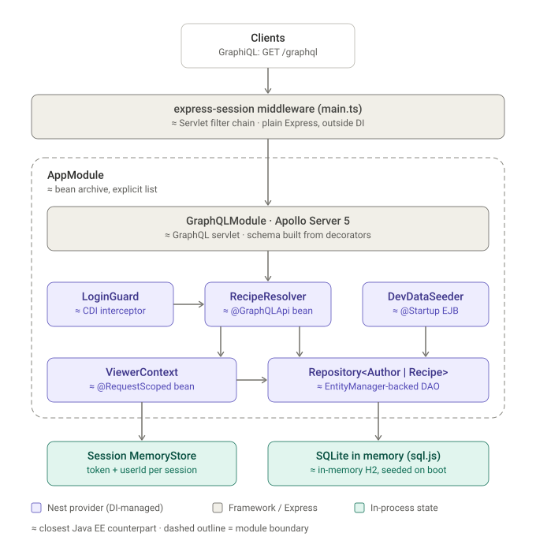
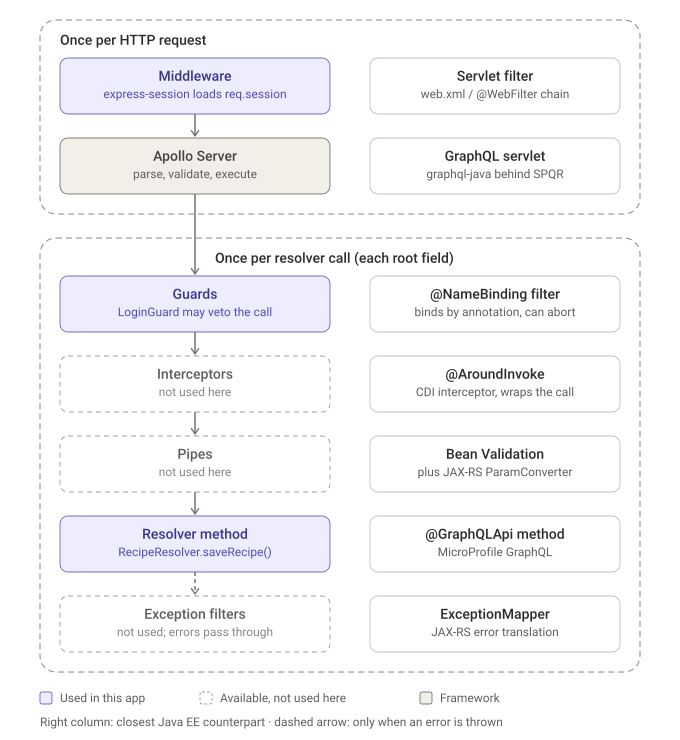

# NestJS backend guide for Java EE developers

This guide covers `recipe-book-nest`, the NestJS port of `recipe-book-java`. It explains each Nest concept the code uses by comparing it to its closest Java EE (Jakarta EE) counterpart.

Written on 11 November 2026 against `@nestjs/core` 12.4, `@nestjs/graphql` 14.2 (Apollo Server 5), TypeORM 1.1 and Node 24. For running and verifying the backend, see [recipe-book-nest/README.md](../recipe-book-nest/README.md).

## Architecture

Each request first passes through `express-session`, which [main.ts](../recipe-book-nest/src/main.ts) registers as plain Express middleware, outside dependency injection. It then reaches `AppModule`. Apollo Server hands each GraphQL operation to `RecipeResolver`, and `LoginGuard` decides whether the call may proceed. The resolver works through the request-scoped `ViewerContext` and the TypeORM repositories. All state lives in process memory and is lost on restart, as with H2 in the Java version.

## Nest concepts in Java EE terms

| Nest concept (where it's used) | Closest Java EE counterpart | The difference that matters |
|---|---|---|
| **Module**: `@Module` in [app.module.ts](../recipe-book-nest/src/app.module.ts) | A bean archive | There's no classpath scanning. A class can only be injected if a module lists it in `providers`. That's like `bean-discovery-mode="none"`, where you register every bean yourself. |
| **Provider**: any `@Injectable()` class (the resolver, guard, `ViewerContext`, seeder) | A CDI managed bean | Providers are singletons by default, like `@ApplicationScoped` but without a proxy. Injection is through the constructor only, matched by the parameter's class. |
| **Dynamic module**: `TypeOrmModule.forRoot()` / `.forFeature([Author, Recipe])` | `persistence.xml` plus `@Produces` methods | `forRoot` sets up the database connection once, like defining the persistence unit. `forFeature` makes `Repository<Author>` and `Repository<Recipe>` injectable in this module. |
| **Injection token**: `@InjectRepository(Author)`, `@Inject(CONTEXT)`, `APP_GUARD` | A CDI qualifier or `@Named` | You need one whenever the class alone can't identify the dependency. Generics are the common case (see the pitfalls below). |
| **Request scope**: `@Injectable({ scope: Scope.REQUEST })` on [viewer-context.ts](../recipe-book-nest/src/service/viewer-context.ts) | `@RequestScoped` | There's no client proxy. Instead, anything that injects a request-scoped provider becomes request-scoped too, so Nest builds a new `RecipeResolver` for every request. |
| **Guard**: `CanActivate` in [login.guard.ts](../recipe-book-nest/src/security/login.guard.ts) | A `ContainerRequestFilter` bound with `@NameBinding`, or the old `CheckLoginAspect` | It runs before the method and either allows the call or throws. It can't wrap the call or change its result; that's what Interceptors are for. |
| **Metadata**: `SetMetadata` in [login-required.decorator.ts](../recipe-book-nest/src/security/login-required.decorator.ts), read with `Reflector` | A `@Retention(RUNTIME)` annotation read with `method.getAnnotation()` | `getAllAndOverride` checks the method first, then the class, so a method-level setting overrides a class-level one. |
| **Global guard**: the `APP_GUARD` entry in `providers` | An interceptor enabled for every bean with `@Priority` | It runs before every resolver and checks for `@LoginRequired` itself, much as the aspect's pointcut did. |
| **ExecutionContext / GqlExecutionContext** | `InvocationContext` | Nest uses one guard API for HTTP, GraphQL, WebSockets and microservices. That's why the guard converts it to the GraphQL view before it can reach `req`. |
| **GraphQL decorators**: `@Resolver`, `@Query`, `@Mutation`, `@Args` in [recipe.resolver.ts](../recipe-book-nest/src/service/recipe.resolver.ts) | MicroProfile GraphQL's `@GraphQLApi`, `@Query`, `@Mutation`, `@Name` | Almost one to one, and SPQR's annotations map the same way. |
| **Schema types**: `@ObjectType`, `@InputType`, `@Field` on the entities, `RecipeDraftInput` and `Login` | MicroProfile GraphQL's `@Type` and `@Input` | Field types are written out, as in `@Field(() => String)`, because most TypeScript type information is gone at runtime (see below). |
| **Lifecycle hook**: `OnApplicationBootstrap` in [dev-data.seeder.ts](../recipe-book-nest/src/dev-data.seeder.ts) | A `@Startup @Singleton` bean's `@PostConstruct`, or `@Observes @Initialized(ApplicationScoped.class)` | It runs once after every module is set up and before the server accepts traffic. You implement an interface method instead of adding an annotation. |
| **Bootstrap**: `NestFactory.create` in [main.ts](../recipe-book-nest/src/main.ts) | The application server | There's no container to deploy into. The app starts its own HTTP server, like Spring Boot or Quarkus. |

## Request lifecycle

- **What runs how often:** Middleware and Apollo Server run once per HTTP request. Everything in the lower box runs once per resolver call. A request containing two mutations runs `LoginGuard` twice: per method call, like a CDI interceptor, not per request like a Servlet filter.
- **The unused stages:**
  - Interceptors are Nest's real `@AroundInvoke`: they run before and after the method and can change the result.
  - Pipes are where Bean Validation-style input checks go, usually with the class-validator package.
  - Exception filters are Nest's `ExceptionMapper`. This app throws `GraphQLError` directly and lets Apollo format it.

## Pitfalls for a Java EE developer

- **One thread, and nothing may block.** All your code runs on a single event-loop thread. Database calls return Promises that you `await`, and other requests run while one waits. There's no thread pool to tune, but a CPU-heavy loop stalls every request.
  - There's no ThreadLocal per request either, which is why request scope builds new objects instead of using a proxy.
  - Node's closest equivalent to ThreadLocal is `AsyncLocalStorage`, and Nest documents it as an alternative to request scope.
- **Decorators are code, not annotations.** `@Field()` runs when the class is first loaded and records its settings in a global metadata registry. At startup, Nest reads that registry to wire the dependencies and build the GraphQL schema. Java annotations do nothing until something reads them through reflection.
- **Types mostly disappear at runtime.**
  - Nest finds constructor dependencies from type information that the TypeScript compiler writes out when `emitDecoratorMetadata` is on in [tsconfig.json](../recipe-book-nest/tsconfig.json). It only records the outer class, so `Repository<Author>` and `Repository<Recipe>` both become plain `Repository`. That's why `@InjectRepository(Author)` is needed as a qualifier.
  - Java erases generics too, but CDI can still read the generic signature at the injection point. TypeScript leaves nothing to read.
  - The same limit explains the explicit `@Field(() => String, { nullable: true })` and `() => [Recipe]`: `string | null` and array element types are lost.
- **`import type` silently breaks injection.** If `ViewerContext` were imported with `import type`, the compiler would drop the import and record the parameter as `Object`, and Nest would fail at startup with "can't resolve dependencies". `Repository` is safely imported with `import type` here only because an explicit token identifies it.
- **`() => Author` delays the class lookup** until the schema is built. That keeps it working when circular imports load files in an awkward order. In Java, the classloader handles this for you.
- **TypeORM is not JPA.**
  - Entities are plain objects. There's no persistence context, no automatic change tracking and no lazy-loading proxies.
  - Nothing is written until you call `save()`, which runs in its own transaction.
  - Relations load only when marked `eager` (as `Recipe.author` is) or explicitly requested.
  - There's no JTA and no `@Transactional`. Work that spans several statements goes inside `dataSource.transaction(...)`.
  - `synchronize: true` works like `hbm2ddl.auto=update`. That's fine for an in-memory database and never for production.
- **Imports end in `.js`** even though the source files are `.ts`. That's how Node resolves ES modules in the compiled output, not a Nest rule.
